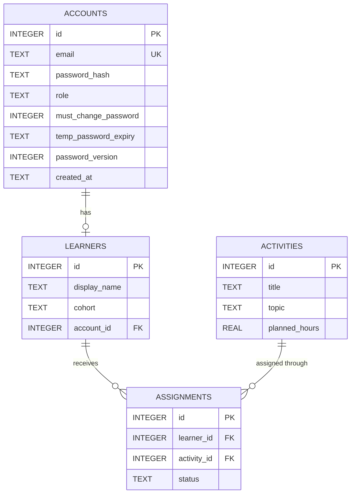

# Learning Progress Tracker

A full-stack web application designed to manage learners, assign learning activities, track training progress, and generate learning performance summaries.

## 1. Project Overview

The Learning Progress Tracker is a centralized training management system that helps coordinators manage candidates and monitor their learning progress.

The application provides two user roles:

- **Coordinator:** Manages learners, activities, assignments, and training reports.
- **Candidate (Learner):** Views assigned activities, updates activity status, and monitors personal progress.

The system uses React for the frontend, Node.js and Express.js for the backend, and SQLite for database management.

## 2. Project Objectives

- Manage candidate information and accounts.
- Create and manage learning activities.
- Assign activities to individual candidates.
- Track learning activity completion.
- Calculate individual progress percentages.
- Monitor overall training completion.
- Generate learner progress summaries.
- Provide secure authentication and role-based authorization.

## 3. Key Features

### 3.1 Coordinator Dashboard

- View registered learner information.
- View available learning activities.
- Monitor assignment completion.
- Track completed and pending activities.
- View individual learner progress.
- Generate overall training summaries.

### 3.2 Candidate Management

- Add new candidates.
- View candidate details.
- Store candidate name, email, and cohort.
- Generate temporary passwords.
- Reset candidate passwords.
- Manage candidate records.

### 3.3 Learner Dashboard

- View assigned learning activities.
- Display activity titles and topics.
- Check activity status.
- Update activity progress.
- Identify completed and pending activities.
- Monitor individual learning progress.

### 3.4 Learning Activity Management

- Create new learning activities.
- Update existing activities.
- Define activity titles.
- Categorize activities by topic.
- Specify planned learning hours.
- Assign activities to candidates.

### 3.5 Reporting

- Individual learner progress summaries.
- Overall training completion statistics.
- Completed assignment counts.
- Learner-wise activity tracking.

## 4. Technology Stack

| Layer | Technology |
|---|---|
| Frontend | React.js |
| Programming Language | JavaScript |
| Frontend Tool | Vite |
| Backend | Node.js |
| Backend Framework | Express.js |
| Database | SQLite |
| Database Library | sql.js |
| Authentication | Express Session |
| Password Security | bcryptjs |
| Session Storage | Redis (production) |
| API Architecture | REST API |
| Testing | Jest and Supertest |
| Version Control | Git and GitHub |
| Deployment | Render |

## 5. Application Architecture

The application follows a client-server architecture.

```text
             USER
               |
               |
        REACT FRONTEND
          (Vite)
               |
               |
           REST API
               |
               |
        EXPRESS SERVER
               |
               |
       AUTHENTICATION
         MIDDLEWARE
               |
               |
          API ROUTES
               |
               |
        DATABASE LAYER
               |
               |
          SQLITE DB
               |
       +-------+-------+
       |       |       |
   ACCOUNTS LEARNERS ACTIVITIES
                       |
                   ASSIGNMENTS
```

### Architecture Explanation

1. Users interact with the React frontend.
2. The frontend sends API requests to Express.
3. The backend validates authentication and authorization.
4. API routes process the requested operation.
5. The database layer executes SQL queries.
6. The backend returns JSON responses.
7. The frontend displays updated information.

## 6. Database Design

The application uses SQLite as its relational database.

**Database location:**

`backend/data/tracker.db`

The database contains four main tables:

1. Accounts
2. Learners
3. Activities
4. Assignments

### 6.1 Accounts Table

Stores login and authentication information.

| Column | Data Type | Description |
|---|---|---|
| id | INTEGER | Primary key |
| email | TEXT | Unique email address |
| password_hash | TEXT | Hashed password |
| role | TEXT | Coordinator or Candidate |
| must_change_password | INTEGER | Password change requirement |
| temp_password_expiry | TEXT | Temporary password expiry |
| password_version | INTEGER | Password version |
| created_at | TEXT | Account creation date |

### 6.2 Learners Table

Stores candidate profile information.

| Column | Data Type | Description |
|---|---|---|
| id | INTEGER | Primary key |
| display_name | TEXT | Candidate name |
| cohort | TEXT | Training cohort |
| account_id | INTEGER | Foreign key referencing Accounts |

### 6.3 Activities Table

Stores available learning activities.

| Column | Data Type | Description |
|---|---|---|
| id | INTEGER | Primary key |
| title | TEXT | Activity title |
| topic | TEXT | Activity category |
| planned_hours | REAL | Planned learning hours |

### 6.4 Assignments Table

Connects learners with their assigned activities.

| Column | Data Type | Description |
|---|---|---|
| id | INTEGER | Primary key |
| learner_id | INTEGER | Foreign key referencing Learners |
| activity_id | INTEGER | Foreign key referencing Activities |
| status | TEXT | Learning activity status |

Supported statuses:

- Not Started
- In Progress
- Completed

A unique constraint on learner_id and activity_id prevents duplicate assignments.

## 7. Database ER Diagram

The following Entity Relationship Diagram represents the database structure.



### 7.1 Database Relationships

**Accounts and Learners**

- An account can be associated with zero or one learner.
- Each learner can have one associated account.
- Coordinator accounts do not require learner records.

**Learners and Assignments**

- One learner can receive multiple assignments.
- Each assignment belongs to one learner.

**Activities and Assignments**

- One activity can be assigned to multiple learners.
- Each assignment references one activity.

**Many-to-Many Relationship**

Learners and activities have a many-to-many relationship through the Assignments table.

For example:

- Jordan Lee receives React Basics and REST APIs.
- Morgan Chen also receives React Basics.
- Each candidate has a separate assignment record and individual status.

## 8. Progress Calculation

Individual learner progress is calculated using completed assignments.

**Formula:**

```text
Individual Progress (%) =

(Completed Activities / Total Assigned Activities) * 100
```

Example:

```text
Total Activities = 4
Completed Activities = 3

Progress = (3 / 4) * 100

Result = 75%
```

Overall training completion:

```text
Overall Completion (%) =

(Total Completed Assignments / Total Assignments) * 100
```

If there are no assignments, the completion percentage is 0%.

Pending activities include activities with Not Started or In Progress status.

## 9. User Roles and Permissions

### Coordinator

The coordinator can:

- Access the coordinator dashboard.
- View learner information.
- Create candidate accounts.
- Manage learning activities.
- Assign activities to learners.
- Reset candidate passwords.
- View training summaries.

### Candidate

The candidate can:

- Access the learner dashboard.
- View personal information.
- View assigned activities.
- Update personal activity status.
- View individual progress.
- Change their password.

### Security Rules

- Coordinator operations require coordinator authorization.
- Candidates must only access their own learning information.
- Backend middleware enforces role permissions.
- Frontend restrictions alone are not sufficient for security.

## 10. API Documentation

**Base API URL:**

```text
http://localhost:3001/api/v1
```

### 10.1 Authentication APIs

| Method | Endpoint | Description |
|---|---|---|
| POST | /auth/login | User login |
| POST | /auth/logout | User logout |
| POST | /auth/change-password | Change password |
| GET | /auth/me | Get current user |

### 10.2 Learner APIs

| Method | Endpoint | Description |
|---|---|---|
| GET | /learners | Get all learners |
| POST | /learners | Create candidate |
| GET | /learners/:id/assignments | Get learner assignments |
| POST | /learners/:id/reset-password | Reset candidate password |

### 10.3 Activity APIs

| Method | Endpoint | Description |
|---|---|---|
| GET | /activities | Get activities |
| POST | /activities | Create activity |
| PUT | /activities/:id | Update activity |

### 10.4 Assignment APIs

| Method | Endpoint | Description |
|---|---|---|
| POST | /assignments | Assign activity |
| PATCH | /assignments/:id/status | Update activity status |
| GET | /me/assignments | Get current candidate assignments |

### 10.5 Reporting API

| Method | Endpoint | Description |
|---|---|---|
| GET | /cohort-summary | Get training summary |

### 10.6 Health Check API

```http
GET /api/v1/health
```

Expected response:

```json
{
  "status": "ok"
}
```

## 11. Project Folder Structure

```text
Learning-Progress-Tracker/
│
├── backend/
│   ├── src/
│   │   ├── db/
│   │   │   ├── database.js
│   │   │   ├── schema.sql
│   │   │   └── seed.js
│   │   │
│   │   ├── middleware/
│   │   │   └── auth.js
│   │   │
│   │   ├── routes/
│   │   │   ├── auth.js
│   │   │   ├── learners.js
│   │   │   ├── activities.js
│   │   │   ├── assignments.js
│  